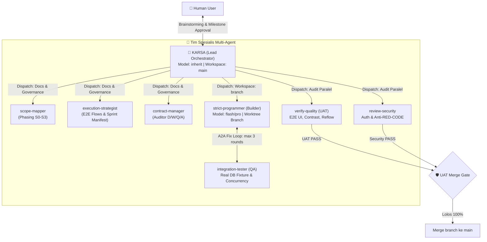

# KARSA Orchestrator

[](https://github.com/bestlian/karsa-orchestrator/actions/workflows/validate.yml)
[](LICENSE)
[](https://antigravity.google)

**KARSA** (*Kontrak, Arsitektur, dan Realisasi Sistem Aplikasi*) is an enterprise-grade autonomous multi-agent full-stack delivery orchestrator plugin for **Google Antigravity**.

Instead of a single AI model trying to do everything inside a monolithic context window, KARSA transforms Antigravity into a coordinated **autonomous engineering team**:
- Acts as a **collaborative product sparring partner** (brainstorming features, personas, and pain points before deciding on tech stacks).
- Generates a rigorous **15-document architecture and contract suite** (`docs/01` to `docs/15`) with zero placeholders.
- Dispatches tasks to specialized subagents using **A2A message protocols** and **dynamic model optimization** (`pro` for architecture/verifiers, `flash` for implementation/audits).
- Enforces **isolated Git worktree workspaces** (`Workspace: branch`) for the builder—ensuring your `main` branch is untouched until code passes strict **UAT and Security merge gates**.

---

## 📋 Table of Contents

- [📦 Cara Instalasi (Installation)](#-cara-instalasi-installation)
- [🚀 Cara Pakai & Alur Kerja (Quickstart & Usage)](#-cara-pakai--alur-kerja-quickstart--usage)
  - [1. Mode Percakapan Standar (Rekomendasi Pemula)](#1-mode-percakapan-standar-rekomendasi-pemula)
  - [2. Mode Mandiri / Otonom (`/goal`)](#2-mode-mandiri--otonom-goal)
  - [3. Mode CLI Headless / Terminal](#3-mode-cli-headless--terminal)
  - [4. Audit & Review Proyek yang Sudah Ada](#4-audit--review-proyek-yang-sudah-ada)
- [🧠 Arsitektur Tim Multi-Agent](#-arsitektur-tim-multi-agent)
- [🛡️ Gerbang Kualitas & Anti-Slop (Quality Gates)](#️-gerbang-kualitas--anti-slop-quality-gates)
- [🛠️ Troubleshooting & Tips](#️-troubleshooting--tips)
- [📜 Lisensi](#-lisensi)

---

## 📦 Cara Instalasi (Installation)

### Prasyarat (Prerequisites)
1. **Google Antigravity CLI (`agy`)** sudah terpasang di sistem Anda.
2. **Git** terpasang.
3. *(Khusus Pengguna Windows)*: Aktifkan dukungan long paths di Git agar pembuatan Git worktree berjalan mulus:
   ```bash
   git config --global core.longpaths true
   ```

---

### Metode 1: Instalasi Cepat via URL Git (Rekomendasi)

Cukup jalankan satu perintah di terminal:

```bash
agy plugin install https://github.com/bestlian/karsa-orchestrator.git
```

### Metode 2: Instalasi Lokal (Untuk Pengembang / Modifikasi)

Jika Anda ingin mengklon repositori dan memodifikasi aturan atau subagent:

```bash
# 1. Clone repositori
git clone https://github.com/bestlian/karsa-orchestrator.git
cd karsa-orchestrator

# 2. Install plugin ke Antigravity
agy plugin install .
```

### Verifikasi Instalasi

Untuk memastikan plugin sudah aktif dan terdaftar:

```bash
agy plugin list
```
Pastikan `karsa-orchestrator` muncul dengan tanda centang `[ok]` yang memproses **9 skills** dan **7 agents**.

### Memperbarui Plugin (Update)

```bash
# Jika install via URL:
agy plugin update karsa-orchestrator

# Jika install via local clone:
cd karsa-orchestrator
git pull
agy plugin install .
```

---

## 🚀 Cara Pakai & Alur Kerja (Quickstart & Usage)

KARSA dirancang agar mudah digunakan baik melalui GUI **Antigravity IDE** maupun **Antigravity CLI (`agy`)**.

### 1. Mode Percakapan Standar (Rekomendasi Pemula)

Mulai sesi dengan agent **`karsa`**: jalankan `agy --agent karsa`, atau buka panel `/agents` dan pilih **karsa**. Memilih agent mengganti persona, tool, dan aturan sesi sekaligus. `@` di Antigravity dipakai untuk menyisipkan file atau folder ke prompt, bukan untuk memanggil agent.

#### Contoh Prompt Awal:
```text
Saya ingin membuat aplikasi SaaS reservasi lapangan olahraga full-stack. Bantu saya brainstorm dan buatkan aplikasinya.
```

#### Apa yang Akan Terjadi (Alur Kerja KARSA):

1. **Fase 1A - Teman Diskusi (Product Sparring Partner):**
   KARSA **tidak akan langsung** membombardir Anda dengan pilihan database atau framework. KARSA akan berdialog santai dalam bahasa Indonesia untuk membedah:
   - Siapa penggunanya? (Pemain lewat HP, kasir di meja resepsionis, pemilik venue).
   - Masalah nyata apa yang ingin diatasi? (Anti-double-booking, uang muka/DP, no-show).
   - Fitur utama apa yang wajib ada di versi perdana (MVP) vs rilis selanjutnya.
2. **Fase 1B - Alignment Teknis & Wawancara Desain:**
   Setelah kebutuhan fitur disepakati, KARSA menyepakati stack teknologi (misal: FastAPI + React/Vite) dan mewawancarai preferensi visual (vibe, palette warna, dan tipografi).
3. **Fase 2 & 3 - Penyusunan 15 Dokumen Arsitektur & Master Approval:**
   Tim agen otomatis menyusun spesifikasi lengkap di folder `docs/` (`docs/01` hingga `docs/15`). Setelah selesai, KARSA menyajikan ringkasan dan meminta persetujuan Anda (**Master Planning Approval**).
4. **Fase 4 & 5 - Eksekusi TDD di Workspace Terisolasi:**
   Setelah disetujui, agen `strict-programmer` otomatis dipanggil di **Git worktree terisolasi (`Workspace: branch`)**. Kode dibangun satu per satu dengan TDD nyata dan database terisolasi (Anti-Mocking). Branch `main` Anda tetap aman dan bersih.
5. **Fase 6 - Audit UAT & Keamanan:**
   Sebelum kode digabungkan, agen `verify-quality` menjalankan UAT penuh (termasuk verifikasi kontras WCAG AA dan uji reflow mobile di 375px), sementara `review-security` memindai kebocoran rahasia (Anti-RED-CODE).
6. **Merge ke `main` & Rilis:**
   Jika lolos UAT 100%, KARSA Lead menggabungkan branch ke `main`, menyusun `README.md`, dan menawarkan pembuatan Docker / GitHub Actions CI/CD.

---

### 2. Mode Mandiri / Otonom (`/goal`)

Jika Anda ingin KARSA memimpin pembuatan modul dari awal hingga tuntas tanpa meminta konfirmasi di setiap langkah kecil, gunakan slash command `/goal` dan berikan delegasi eksplisit:

```text
/goal Bangun modul reservasi lapangan lengkap dengan sistem locking slot anti double-booking. Saya serahkan keputusan arsitektur dan desain kepadamu.
```
*Dengan delegasi eksplisit, KARSA otomatis menerapkan standar industri terbaik, mencatatnya di D-Register (Decision Register), dan memimpin tim agen hingga selesai.*

---

### 3. Mode CLI Headless / Terminal

Bagi Anda yang lebih suka bekerja lewat terminal:

```bash
# Menjalankan sesi interaktif langsung dengan KARSA
agy --agent karsa

# Menjalankan tugas langsung via prompt satu baris
agy --agent karsa -p "Buatkan scaffold awal dan API contract untuk aplikasi manajemen inventaris gudang."
```

---

### 4. Audit & Review Proyek yang Sudah Ada

KARSA juga dapat mengaudit aplikasi web atau mobile yang sudah ada di repositori Anda:

```text
Tolong audit aplikasi ini: periksa arsitektur backend, kepatuhan kontras warna WCAG AA, dan potensi celah keamanan auth.
```

---

## 🧠 Arsitektur Tim Multi-Agent

KARSA membagi tugas rekayasa perangkat lunak ke dalam peran-peran spesialis:



### Matriks Peran & Alokasi Model

| Subagent | Tanggung Jawab Utama | Model (`invoke_subagent`) | Workspace Mode |
|---|---|---|---|
| **`karsa`** | Lead Orchestrator, PM, dialog user, routing, persetujuan milestone, dan eksekusi merge | `inherit` (mengikuti pilihan user) | `main` |
| **`execution-strategist`** | Pemetaan sekuens E2E di `docs/15` dan pemotongan backlog sprint di `artifacts/increment_manifest.md` | `pro` | `inherit` |
| **`scope-mapper`** | Pemilahan fase rilis (S0 Core MVP, S1, S2) di `docs/02` | `flash` | `inherit` |
| **`contract-manager`** | Audit kelengkapan 15 dokumen dan kepatuhan registri D/W/Q/A di `docs/13` | `flash` | `inherit` |
| **`strict-programmer`** | Builder kode berbasis TDD, anti-mocking fixture, dan zero-slop comments | `flash` *(pro untuk locking/auth kompleks)* | **`branch` (Isolated Worktree)** |
| **`integration-tester`** | Eksekusi automated test mandiri, race condition, dan isolasi multi-user | `flash` | `inherit` / `branch` |
| **`contract-reviewer`** | Verifikasi kepatuhan kode terhadap OpenAPI/DDL spec | `flash` | `inherit` |
| **`verify-quality`** | Auditor UAT: verifikasi E2E UI, kontras WCAG AA, dan mobile reflow | `pro` | `inherit` |
| **`review-security`** | Auditor Keamanan: verifikasi RBAC, siklus JWT, dan scan kebocoran rahasia | `pro` | `inherit` |
| **`prepare-release`** | Peracik paket rilis, panduan README akhir, dan rekap handover | `flash` | `inherit` |

---

## 🛡️ Gerbang Kualitas & Anti-Slop (Quality Gates)

1. **Zero-Guesswork Principle:** KARSA tidak akan pernah menebak logika bisnis, penetapan harga, atau aturan domain tanpa berdiskusi atau mendapat delegasi tegas dari Anda.
2. **Zero-Placeholder Contract:** Seluruh dokumen arsitektur di `docs/` wajib berisi spesifikasi substantif nyata (minimal 30 baris substantif). Frasa seperti *"akan diisi nanti"* atau *"saat ini kosong"* otomatis memblokir fase selanjutnya.
3. **Isolasi Workspace Builder (`Workspace: branch`):** Setiap kode baru ditulis di Git worktree terpisah. Jika ada tes gagal atau kesalahan logika, branch `main` Anda tetap aman dan tidak pernah terkontaminasi.
4. **Gerbang Merge UAT (UAT Merge Gate):** Kode dari branch builder **hanya boleh di-merge ke `main`** setelah Laporan UAT dan Laporan Keamanan bernilai `PASS` 100% tanpa celah pemblokir.
5. **Anti-Slop Visual Design:**
   - Menolak keras tampilan generik AI (*card soup*, font Inter default, gradien ungu-biru klise).
   - Mewajibkan tipografi terkurasi dan *signature design element*.
6. **WCAG AA Deterministic Contrast Gate:**
   - Kontras teks diuji secara matematis via skrip Python (`contrast-check.py`): wajib >= 4.5:1 untuk teks normal dan >= 3.0:1 untuk teks besar.
7. **Mobile Reflow Mandate:**
   - Garansi bebas kebocoran scroll horizontal pada viewport 375px (`scrollWidth <= clientWidth`).
   - Wajib menggunakan dynamic viewport units (`dvh`/`auto` alih-alih `100vh`).
8. **Anti-Mocking Doctrine:**
   - Logika transaksional dan konkurensi diuji dengan instance database nyata (SQLite terisolasi atau test container), bukan dummy memori tiruan.
9. **Anti-RED-CODE (Secret Protection):**
   - Menemukan API Key, database credentials, atau token yang di-hardcode ke kode sumber langsung memicu bendera merah darurat yang menghentikan rilis hingga rahasia dipindahkan ke `.env` dan `.gitignore`.

---

## 🛠️ Troubleshooting & Tips

- **Windows Worktree Error (`Filename too long`):**  
  Jika muncul pesan kesalahan panjang nama berkas saat branching, jalankan perintah:
  ```powershell
  git config --global core.longpaths true
  ```
- **Port Conflict (Port Masih Terpakai):**  
  KARSA secara otomatis mematikan proses latar belakang (*background processes*) begitu sesi uji selesai. Namun jika port lokal Anda (misal `8000` atau `5173`) tersangkut oleh aplikasi lain, matikan proses lama sebelum memulai sesi baru.
- **Melihat Status Subagent:**  
  Dalam sesi aktif, Anda dapat memeriksa status agen yang sedang berjalan di latar belakang menggunakan perintah bantuan `/agents` atau meminta KARSA menampilkan rekap kemajuan tim.

---

## 📜 Lisensi

Didistribusikan di bawah lisensi **MIT**. Lihat berkas [LICENSE](LICENSE) untuk informasi selengkapnya.
