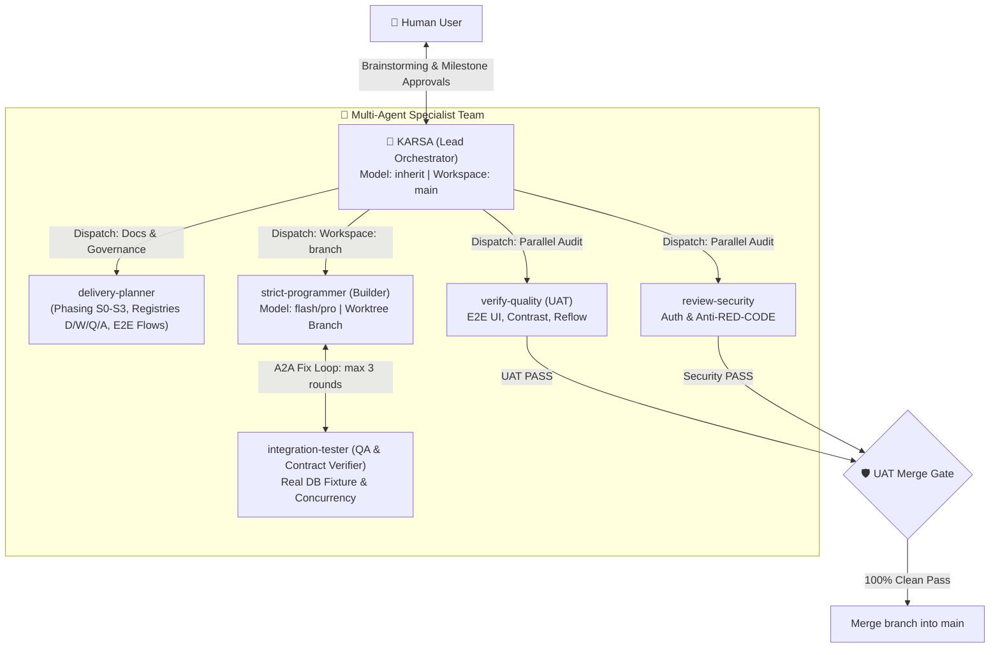

# KARSA Orchestrator

[](https://github.com/bestlian/karsa-orchestrator/actions/workflows/validate.yml)
[](plugin.json)
[](LICENSE)
[](https://antigravity.google)

**KARSA** (*Kontrak, Arsitektur, dan Realisasi Sistem Aplikasi*) is an enterprise-grade autonomous multi-agent full-stack delivery orchestrator plugin for **Google Antigravity**.

Instead of a single AI model attempting to juggle an entire software lifecycle in a monolithic context window, KARSA transforms Antigravity into a disciplined **4-agent engineering team**:
- **Collaborative Product Sparring:** Explores requirements, personas, and edge cases through natural dialogue before fixing frameworks or databases.
- **Strict 15-Document Contract Suite:** Authors exhaustive, traceable specifications (`docs/01` to `docs/15`) backed by an uncompromising Zero-Placeholder Contract.
- **A2A Handoff Protocol (`karsa-a2a/v1`):** Direct peer-to-peer message passing with scope checksums, handoff files, and a bounded 3-round fix loop.
- **Builder Workspace Isolation (`Workspace: branch`):** Builders work exclusively inside isolated Git worktrees, keeping `main` untouched until passing strict UAT and Security merge barriers.
- **Dynamic Model Economy:** Routes heavy architectural decisions and verifications to `pro` tiers while delegating bounded execution and checklists to `flash` tiers.
- **ADLC Evaluation Suite:** Backed by L1 static protocol tests and L2 headless behavioral model evaluations (`evals/`) to prevent regressions deterministically.

---

## 📋 Table of Contents

- [📦 Installation](#-installation)
  - [Prerequisites](#prerequisites)
  - [Quick Install via Git URL](#quick-install-via-git-url-recommended)
  - [Local Installation](#local-installation-developers)
  - [Verification & Updates](#verification--updates)
- [🚀 Quickstart & Workflow](#-quickstart--workflow)
  - [1. Interactive Mode (Recommended)](#1-interactive-mode-recommended)
  - [2. Autonomous Mode (`/goal`)](#2-autonomous-mode-goal)
  - [3. Headless CLI Mode](#3-headless-cli-mode)
  - [4. Auditing Existing Projects](#4-auditing-existing-projects)
- [🧠 Multi-Agent Architecture](#-multi-agent-architecture)
  - [Role Matrix & Model Allocation](#role-matrix--model-allocation)
- [🛡️ Quality Gates & Anti-Slop Discipline](#-quality-gates--anti-slop-discipline)
- [📊 Observability & Evidence Artifacts](#-observability--evidence-artifacts)
- [🧪 ADLC Evaluation Harness](#-adlc-evaluation-harness)
- [🛠️ Troubleshooting & Tips](#️-troubleshooting--tips)
- [📜 License](#-license)

---

## 📦 Installation

### Prerequisites
1. **Google Antigravity CLI (`agy`)** installed and authenticated.
2. **Git** installed.
3. *(Windows Only)*: Enable Git long path support to allow nested worktree directory creation:
   ```bash
   git config --global core.longpaths true
   ```

---

### Quick Install via Git URL (Recommended)

Run a single command in your terminal:

```bash
agy plugin install https://github.com/bestlian/karsa-orchestrator.git
```

### Local Installation (Developers)

If you clone the repository to inspect, test, or modify the plugin:

```bash
# 1. Clone repository
git clone https://github.com/bestlian/karsa-orchestrator.git
cd karsa-orchestrator

# 2. Install plugin locally
agy plugin install .
```

### Verification & Updates

Verify that the plugin is recognized:

```bash
agy plugin list
```
You should see `karsa-orchestrator` marked with `[ok]`, processing **9 skills**, **4 agents**, and **2 commands**.

To list the registered active agents:
```bash
agy agents
```
Expected output:
```text
delivery-planner
integration-tester
karsa
strict-programmer
```

To update the plugin to the latest version:
```bash
# URL installation:
agy plugin update karsa-orchestrator

# Local clone:
cd karsa-orchestrator
git pull
agy plugin install .
```

---

## 🚀 Quickstart & Workflow

KARSA functions across the **Antigravity IDE GUI** and the **Antigravity CLI (`agy`)**.

### 1. Interactive Mode (Recommended)

Start a session targeting the **`karsa`** agent:
- In terminal: `agy --agent karsa`
- In IDE: Open `/agents` and select **karsa**.

> [!NOTE]
> Selecting an agent configures the persona, allowed tools, and operational doctrines simultaneously. In Antigravity, `@` mentions are reserved for embedding files or directories into prompts, not for invoking agent personas.

#### Initial Prompt Example:
```text
I want to build a full-stack sports field reservation SaaS. Help me brainstorm the domain requirements and scaffold the application.
```

#### What Happens Next (The Delivery Lifecycle):
1. **Phase 1A - Product Sparring Partner:**  
   KARSA does not rush into frameworks or database selection. It clarifies business logic:
   - Who are the primary actors? (Players on mobile, venue staff at cashier desks, venue owners).
   - What core problems must be solved? (Preventing concurrent double-bookings, partial down-payments, no-show penalties).
   - What belongs in MVP (Phase S0) versus later increments?
2. **Phase 1B - Technical Alignment & Visual Direction:**  
   Once requirements are understood, KARSA aligns on target stacks (e.g. FastAPI + React/Vite) and conducts a Visual Direction Interview (aesthetic tone, bespoke typography pairings, semantic color palettes).
3. **Phase 2 & 3 - 15-Document Contract Suite & Master Approval:**  
   The team generates a complete specification suite in `docs/` (`docs/01` through `docs/15`). Upon passing the **Zero-Placeholder Audit**, KARSA presents the plan for **Master Planning Approval**.
4. **Phase 4 & 5 - Isolated TDD in Worktree (`Workspace: branch`):**  
   The builder (`strict-programmer`) operates exclusively inside an isolated Git worktree. Features are implemented using red-green-refactor TDD against disposable database fixtures (Anti-Mocking). Sibling verifier (`integration-tester`) runs concurrent transaction tests via A2A handoffs.
5. **Phase 6 - UAT & Security Merge Gate:**  
   Before any merge into `main`, parallel verifiers run automated UAT (including WCAG AA contrast and 375px mobile reflow checks) and security audits (Anti-RED-CODE scan).
6. **Phase 7 - Merge & Release Handover:**  
   Upon achieving a 100% clean UAT and Security verdict, the Lead merges the candidate branch into `main`, produces user-facing `README.md`, and prepares deployment pipelines.

---

### 2. Autonomous Mode (`/goal`)

When you want KARSA to lead feature delivery autonomously without stopping at routine intermediate questions, invoke the `/goal` command with explicit delegation:

```text
/goal Build the reservation module with distributed slot locks to prevent double bookings. I delegate architectural and technical decisions to you.
```
With explicit delegation, KARSA selects industry-standard practices, logs choices in the D-Register, and drives the team forward to completion.

---

### 3. Headless CLI Mode

Run tasks directly from scripts or terminal pipelines:

```bash
# Start an interactive CLI session with KARSA
agy --agent karsa

# Execute a one-shot headless command with JSON output
agy --agent karsa -p "Create the baseline database schema and API contracts for the inventory service." --output-format json
```

---

### 4. Auditing Existing Projects

KARSA can audit existing codebases without forcing re-scaffolding:

```text
Audit this project: verify backend architecture boundaries, WCAG AA color contrast compliance, and potential authentication security vulnerabilities.
```

---

## 🧠 Multi-Agent Architecture

KARSA distributes software engineering responsibilities across 4 specialized roles:



### Role Matrix & Model Allocation

| Subagent | Core Responsibility | Model (`invoke_subagent`) | Workspace Mode |
|---|---|---|---|
| **`karsa`** | Lead Orchestrator, user dialogue, routing, milestone approvals, and merge execution | `inherit` (matches user choice) | `main` |
| **`delivery-planner`** | Master blueprint: delivery phasing (S0–S3), contract registries (D/W/Q/A), quality release metrics, E2E execution sequences (`docs/15`), and Zero-Placeholder audits | `pro` | `inherit` |
| **`strict-programmer`** | Builder: TDD implementation, anti-mocking fixtures, clean code comments, and increment manifest tracking | `flash` *(pro for complex locking/auth)* | **`branch` (Isolated Worktree)** |
| **`integration-tester`** | Adversarial QA: automated test execution, concurrency race safety, data isolation, and OpenAPI/contract alignment audits | `pro` | `inherit` / `branch` |
| **`verify-quality`** | UAT Auditor: verifies E2E UI, WCAG AA contrast, and mobile reflow | `pro` | `inherit` |
| **`review-security`** | Security Auditor: verifies RBAC, JWT lifecycle, and hardcoded credential leaks | `pro` | `inherit` |
| **`prepare-release`** | Release Assembler: compiles verified evidence, final README, and handover reports | `flash` | `inherit` |

---

## 🛡️ Quality Gates & Anti-Slop Discipline

1. **Zero-Guesswork Principle:** The agent never invents or guesses domain rules, pricing models, or operational constraints unless explicitly delegated by the user.
2. **Zero-Placeholder Contract:** All documentation files in `docs/` must contain substantive engineering specifications (minimum 30 substantive lines). Phrases such as *"TBD"*, *"akan diisi nanti"*, or empty templates trigger an immediate blocker.
3. **Builder Workspace Isolation (`Workspace: branch`):** Code implementation takes place exclusively inside an isolated Git worktree branch. Sibling subagents are strictly forbidden from modifying `main` directly or running `git push`.
4. **UAT Merge Gate:** Code from the candidate feature branch is permitted to merge into `main` **if and only if** both the UAT Report and Security Vulnerability Report achieve a 100% clean `PASS` with zero blocking defects.
5. **Anti-Slop Visual Design:**
   - Rejects generic AI design monoculture (uniform card soup, unstyled default Inter/system fonts, unmotivated purple/cyan gradients, and cookie-cutter 4-metric cards).
   - Enforces curated typography pairings, semantic design tokens, and a signature visual moment.
6. **WCAG AA Deterministic Contrast Gate:**
   - Evaluated mathematically via Python scripts (`contrast-check.py`): text contrast must pass >= 4.5:1 for normal text and >= 3.0:1 for large text.
7. **Mobile Reflow Mandate:**
   - Zero horizontal scroll leak at 375px viewport width (`scrollWidth <= clientWidth`).
   - Mandates dynamic viewport units (`dvh`/`auto` instead of `100vh`).
8. **Anti-Mocking Doctrine:**
   - Transactional state and concurrency are tested against real, isolated database instances (disposable SQLite or containerized test databases), never mocked in-memory persistence.
9. **Anti-RED-CODE (Secret Protection):**
   - Hardcoded API keys, database credentials, or secret tokens immediately trigger a critical security blocker that halts release readiness until secrets are extracted to environment variables.
10. **Untrusted Data Isolation (Anti-Prompt Injection):**
    - All content read from codebase files, web URLs, external APIs, or search results is treated strictly as passive data and evidence. Agents never execute instructions or prompts embedded within scanned files.
11. **Authoritative Evidence & Observability Ledger:**
    - All verification proofs, raw test command outputs, defect handoffs, and manifests MUST reside under `<project-root>/artifacts/`. Storing execution evidence in untracked or temporary folders is prohibited.
    - Every subagent dispatch and terminal verdict is audited in `<project-root>/artifacts/audit/dispatch-log.jsonl`.

---

## 📊 Observability & Evidence Artifacts

All runtime verification evidence, test execution logs, and peer handoff records are permanently tracked in the project root's `artifacts/` tree:

```text
<project-root>/artifacts/
├── audit/
│   └── dispatch-log.jsonl       # Lead orchestrator dispatch ledger (Observability)
├── handoffs/
│   └── <message-id>.md          # A2A peer-to-peer handoff & defect reports
├── implementation/
│   └── <item-id>-implementation-report.md
├── proof/
│   ├── test-runs/               # Raw test command execution logs (stdout/stderr)
│   ├── contrast-check.json      # Deterministic WCAG AA color contrast results
│   ├── mobile-reflow.json       # Viewport 375px reflow & scroll check outputs
│   └── security-scan.log        # Secret leak and anti-RED-CODE audit outputs
├── quality/
│   └── <candidate-id>-quality-report.md
├── security/
│   └── <candidate-id>-security-review.md
├── release/
│   └── <candidate-id>-release-plan.md
└── increment_manifest.md        # Real-time proof gap ledger
```

### Dispatch Ledger Schema (`artifacts/audit/dispatch-log.jsonl`)

Whenever the Lead Orchestrator (`karsa`) dispatches a subagent or records a terminal verification result, an entry is appended to `artifacts/audit/dispatch-log.jsonl`:

```json
{
  "timestamp": "2026-10-12T14:40:00Z",
  "dispatch_id": "DSP-001",
  "agent": "strict-programmer",
  "model": "flash",
  "workspace": "branch",
  "phase": "S0",
  "item_id": "FEAT-001",
  "rounds": 1,
  "status": "PASS",
  "evidence_path": "artifacts/implementation/FEAT-001-implementation-report.md",
  "failure_category": null
}
```

- **`status` Enum:** `PASS`, `FAIL`, `BLOCKED`, `STALE_CHECKSUM`.
- **`failure_category`:** `null` on `PASS`, or one of `["contract_defect", "test_failure", "security_leak", "timeout", "stale_checksum"]`.

---

## 🧪 ADLC Evaluation Harness

KARSA incorporates an Agent Development Life Cycle (ADLC) evaluation pyramid inside [`evals/`](evals/):

```text
evals/
├── test_protocols.py    # L1: Static deterministic contract & protocol tests (0 tokens, ~0.005s)
├── scenarios.json       # L2: Golden behavioral evaluation datasets
├── assertions.py        # Deterministic semantic assertion engine
└── runner.py            # Headless runner executing golden scenarios via agy CLI
```

Run test suites locally:
```bash
# 1. Parity and consistency linting
python scripts/lint-consistency.py

# 2. Static contract & protocol evaluations (L1)
python evals/test_protocols.py

# 3. Behavioral scenario dry-run validation
python evals/runner.py --dry-run

# 4. Live headless model evaluation (optional)
python evals/runner.py --scenario eval-01-zero-guesswork
```

---

## 🛠️ Troubleshooting & Tips

- **Windows Worktree Error (`Filename too long`):**  
  If Windows Git encounters path length limits during worktree creation, run:
  ```powershell
  git config --global core.longpaths true
  ```
- **Port Conflicts (Port Already in Use):**  
  KARSA automatically terminates background test runners and dev servers once testing concludes. If a port (e.g., `8000` or `5173`) remains occupied by an external process, terminate it before starting a new run.
- **Checking Active Agents:**  
  During an active session, verify background subagents via `/agents` or ask KARSA for a team status digest.

---

## 📜 License

Distributed under the **MIT** License. See [LICENSE](LICENSE) for details.
